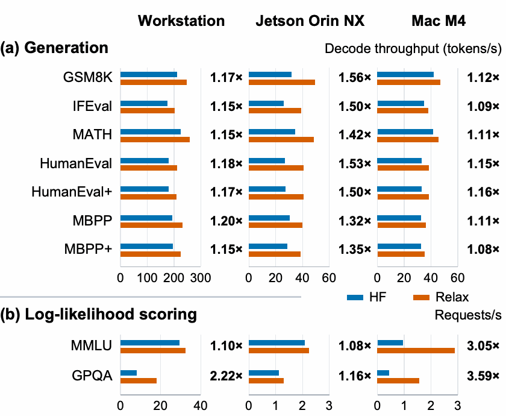

# fast-dllm-relax

Compiles the block-diffusion language model
[Fast-dLLM v2 1.5B](https://huggingface.co/Efficient-Large-Model/Fast_dLLM_v2_1.5B) with
[Apache TVM](https://github.com/apache/tvm) Relax, and benchmarks the compiled model against the
Hugging Face reference implementation on nine lm-eval tasks. The repo covers three hardware targets:

| Target | Artifact | Built on | Runs on |
|---|---|---|---|
| Desktop NVIDIA GPU (default) | bf16 or fp16, cuBLAS + CUTLASS + dlight | the GPU machine | the GPU machine |
| Jetson Orin | bf16 or fp16, cuBLAS + dlight (no CUTLASS) | x86_64 workstation (cross-compile) | Jetson Orin |
| Apple-silicon Mac (Metal) | fp16, dlight only, in-graph attention, int32 kernel indexing | x86_64 workstation (cross-compile), or the Mac | Mac (linked there) |

The compiled model keeps the Fast-dLLM v2 decoding algorithm: 32-token blocks, refined in 8-token
sub-blocks, with every position above a 0.9 confidence threshold unmasked in parallel. It also
keeps the prefix KV cache and the per-layer block cache. Compilation produces a Relax VM executable with ten
entry points (`embed`, `forward_hidden`, `get_logits`, `build_prefix_cache`, `forward_cached`,
`forward_cached_block`, `forward_block_partial_rp{0,8,16,24}`). Metal artifacts add four static-shape
variants (`forward_cached_b32`, `forward_cached_block_b32`, `get_logits_m8`, `get_logits_m32`). A Python
driver (`fast_dllm_relax/runtime.py`) runs the decoding loop.

## Results

<!-- FIGURE: accuracy vs. HF baseline across the 9 tasks -->

Speedups from compiling Fast-dLLM v2 with Relax, compared with the Hugging Face implementation, on a
desktop GPU workstation, a Jetson Orin NX and a Mac M4. Labels show the Relax/HF throughput ratio.



<!-- Vector version: [docs/figures/throughput_speedup.pdf](docs/figures/throughput_speedup.pdf). -->

## Repository layout

```
3rdparty/tvm/            apache/tvm submodule, pinned at a7bfc857b
patches/                 local TVM patch (applied by scripts/setup_tvm.sh)
configs/tvm/             config.cmake presets: cuda, jetson, mac
fast_dllm_relax/
  model/cuda.py          Relax model + opt_fast_dllm_llm_cublas pipeline (desktop GPU, Jetson)
  model/metal.py         in-graph-attention variant + opt_fast_dllm_llm_native pipeline (Metal)
  runtime.py             block-diffusion decoding loop, KV/block caches, loglikelihood scoring
  runners.py             HF baseline runner and Relax runner (shared metrics/recording)
  lm_eval_harness.py     lm-eval model types `fast_dllm_baseline` and `fast_dllm_relax`
  cli.py                 single-prompt demo / quick benchmark
  targets/               Jetson and Metal cross-compile helpers
scripts/
  setup_tvm.sh           build the patched TVM
  export_cuda.py         export desktop-GPU / Jetson artifacts
  export_metal.py        export the Metal artifact (cross-compile, or natively on the Mac)
  link_metal.py          (on the Mac) link + load-check the Metal artifact
  eval.sh                run one benchmark task
lm_eval_tasks/           local copies of lm-eval task configs (see "Benchmarks")
tests/                   tiny-config compile tests (no checkpoint needed)
```

## Setup

The repo pins TVM to `apache/tvm@a7bfc857b` and adds a small patch
(`patches/tvm-a7bfc857b.patch`):

| File | Change |
|---|---|
| `python/tvm/relax/backend/cuda/cublas.py` | cuBLAS pattern rejects batched×batched matmuls, so cuBLAS claims only the 2D-weight projection GEMMs |
| `python/tvm/contrib/cutlass/{gemm_operation,gen_tensor_op}.py` | CUTLASS codegen fixes (stream lookup, symbolic head_dim) |
| `src/relax/backend/contrib/codegen_c/codegen_c.h` | emit the `__tvm_ffi_<name>` entry points the new FFI uses to load CUTLASS kernels |
| `src/arith/iter_affine_map.cc`, `python/tvm/topi/nn/batch_matmul.py` | accept the symbolic `(prefix_len + 32)`-style shapes of the GQA attention matmuls and of the stacked-layer KV concat in the static-block cached forwards |
| `src/target/opt/build_metal_off.cc` | a `USE_METAL=OFF` build serializes Metal modules in the layout the Metal runtime loads (needed to cross-compile for the Mac) |
| `python/tvm/s_tir/dlight/gpu/matmul.py`, `cmake/modules/CUDA.cmake` | MLC branch fixes: skip software pipelining in dlight GEMM on low-SM GPUs; default CUDA arch list with CUTLASS |

### Desktop GPU workstation (also the cross-compile host)

Requirements:
- CUDA toolkit with `nvcc` on `PATH`, plus cmake and ninja;
- LLVM with the AArch64 target (`llvm-config --targets-built`), needed for the Jetson and Mac cross-compiles;
- `aarch64-linux-gnu-g++` (Jetson cross-compile only).

```bash
git clone --recursive <this repo> && cd fast-dllm-relax
python -m venv .venv && source .venv/bin/activate
pip install torch --index-url https://download.pytorch.org/whl/cu128   # match your CUDA
pip install -e ".[eval,test]"

CUDA_ARCH=89 INSTALL_PY=1 bash scripts/setup_tvm.sh cuda   # set CUDA_ARCH to your GPU's SM
export TVM_LIBRARY_PATH=$PWD/3rdparty/tvm/build
export PYTHONPATH=$PWD/3rdparty/tvm/python:$PWD
python -c "import tvm; print(tvm.__file__, tvm.support.libinfo()['USE_CUBLAS'])"
pytest tests/
```

Use a dedicated venv. If another TVM or tvm-ffi is installed in editable mode in the same
environment, its import hook takes precedence over `PYTHONPATH`, and Python silently mixes two
TVM builds. The check above should print `3rdparty/tvm/python/tvm/__init__.py`.

### Jetson Orin

Build the runtime on the device with `bash scripts/setup_tvm.sh jetson` (CUDA + cuBLAS, no
CUTLASS, no LLVM). Then install the Python packages as above, using the JetPack PyTorch wheel.

### Mac (Apple silicon)

Install Xcode Command Line Tools and Homebrew LLVM. Build the runtime on the Mac with
`bash scripts/setup_tvm.sh mac` (Metal + LLVM). Then install the Python packages as above.

## Export

All exports load the checkpoint at its pinned HF revision (`25093b6f…`). They write to `artifacts/`.

```bash
# Desktop GPU: bf16 (the checkpoint's native dtype) or fp16
python scripts/export_cuda.py                     # -> artifacts/fast_dllm_relax_bf16/
python scripts/export_cuda.py --dtype float16     # -> artifacts/fast_dllm_relax_fp16/

# Jetson Orin: cross-compile on the workstation, then copy the directory to the Jetson
python scripts/export_cuda.py --target jetson_orin   # -> artifacts/fast_dllm_relax_bf16_jetson_orin/

# Mac: cross-compile on the workstation and copy the directory to the Mac, or export on the Mac
# itself (same command; put Homebrew LLVM on PATH: export PATH=/opt/homebrew/opt/llvm/bin:$PATH).
# Then link on the Mac.
python scripts/export_metal.py                    # -> artifacts/fast_dllm_relax_fp16_metal/
python scripts/link_metal.py --artifact-dir artifacts/fast_dllm_relax_fp16_metal   # on the Mac
```

A native export takes a few minutes and ends with a smoke run of every exported function. It
fails if cuBLAS claimed no kernels, which happens when TVM is built without `USE_CUBLAS`.

## Benchmarks

Quick check on one prompt:

```bash
python -m fast_dllm_relax.cli --backend relax --use-block-cache --artifact-dir artifacts/fast_dllm_relax_bf16
python -m fast_dllm_relax.cli --backend baseline --use-block-cache
```

Full benchmark tasks run through lm-eval, one task per call:

```bash
BACKEND=relax TASK=gsm8k bash scripts/eval.sh
BACKEND=hf    TASK=gsm8k bash scripts/eval.sh
LIMIT=5 BACKEND=relax TASK=ifeval bash scripts/eval.sh          # smoke run
BACKEND=relax TASK=gsm8k CHUNKED=1 ARTIFACT_DIR=artifacts/fast_dllm_relax_bf16_jetson_orin bash scripts/eval.sh   # Jetson
BACKEND=relax TASK=gsm8k DEVICE=metal:0 ARTIFACT_DIR=artifacts/fast_dllm_relax_fp16_metal bash scripts/eval.sh  # Mac
```

| `TASK` | lm-eval task | Type |
|---|---|---|
| `gsm8k` | `gsm8k_local` (0-shot, CoT + `\boxed{}` prompt) | generative |
| `ifeval` | `ifeval` | generative |
| `humaneval`, `humaneval_plus` | `humaneval_local`, `humaneval_plus_local` | generative, code execution |
| `mbpp`, `mbpp_plus` | `mbpp_local`, `mbpp_plus_local` | generative, code execution |
| `math` | `minerva_math_*_local` (7 subtasks) | generative |
| `mmlu` | `mmlu` (5-shot) | loglikelihood |
| `gpqa` | `gpqa_main_n_shot` (5-shot) | loglikelihood |

Every task uses the chat template, batch size 1, and max 2048 new tokens. Results go to
`results/<backend>/<task>/`: lm-eval's `lm_eval_results.json`, plus, for generative tasks,
per-request records (`lm_eval_requests.jsonl`: prompt, response, latency, token counts) and a
summary with aggregate throughput and memory (`lm_eval_summary.json`).

- `lm_eval_tasks/` holds local copies of the task configs. They use the official Fast-dLLM v2 prompts,
  and they drop a `trust_remote_code` dataset argument that newer `datasets` releases reject. The task names
  end in `_local`.
- The code tasks run model-generated Python on your machine
  (`--confirm_run_unsafe_code`, `HF_ALLOW_CODE_EVAL=1`), so run them somewhere you trust.
- `gpqa` needs `HF_TOKEN` for an account that has accepted the gated `Idavidrein/gpqa` dataset.
- `CHUNKED=1` builds the prefix KV cache one block at a time. It is much faster for long prompts
  on the CUTLASS-less Jetson build, and slower on a desktop GPU.

## Validation status

- **Desktop GPU (RTX 4500 Ada, sm_89, CUDA 12.8).** Fresh build of this repo, GSM8K first 200 problems:
  - bf16: token-identical to the run behind the reported numbers (accuracy 61.0%, ~249 tok/s).
  - fp16: token-identical to the run behind the reported numbers (accuracy 63.0%, ~252 tok/s).
  - The loglikelihood path (MMLU, GPQA) and the HF baseline are identical to the original code.
- **Jetson Orin (L4T R36.4, CUDA 12.6, MAXN).** bf16 artifact cross-compiled on the workstation,
  runtime built on the device, `CHUNKED=1`:
  - GSM8K first 200: token-identical to the run behind the reported numbers (accuracy 58.5%, ~49.7 tok/s).
  - MMLU (5 per subject, 1,140 requests): loglikelihoods bit-identical to the reported run.

  To check on the device:
  1. `bash scripts/setup_tvm.sh jetson`
  2. copy `artifacts/fast_dllm_relax_bf16_jetson_orin/` from the workstation
  3. `LIMIT=200 CHUNKED=1 BACKEND=relax TASK=gsm8k ARTIFACT_DIR=artifacts/fast_dllm_relax_bf16_jetson_orin bash scripts/eval.sh`
- **Mac (M4, macOS 26).** Artifact cross-compiled on the workstation (LLVM 18), linked on the Mac:
  - GSM8K first 200: token-identical to the run behind the reported numbers (accuracy 60.0%, ~47.6 tok/s).
  - MMLU (5 per subject, 1,140 requests): loglikelihoods bit-identical to the reported run.
  - A Mac-native export of the same commit has the same weights and equivalent kernels, and is
    token-identical.
  - The first run after linking is slower while macOS compiles and caches the Metal shaders.

  Artifacts exported before `forward_cached_block` and the tied `lm_head` do not load; re-export
  them with `scripts/export_metal.py`. To check on the device:
  1. `bash scripts/setup_tvm.sh mac`
  2. `python scripts/link_metal.py --artifact-dir artifacts/fast_dllm_relax_fp16_metal`
  3. `python -m fast_dllm_relax.cli --backend relax --use-block-cache --device metal:0 --artifact-dir artifacts/fast_dllm_relax_fp16_metal`

## Notes

- **Two cached forwards.** `forward_cached` returns the prefix KV cache extended by the active
  block; the runtime uses it only where that cache is kept (block-append, chunked prefill).
  Refinement full steps and loglikelihood scoring use `forward_cached_block`, which returns just
  the block's K/V and skips restacking the whole prefix cache on every step. Artifacts exported
  before this function existed do not load; re-export them.
- **Tied output weight.** The checkpoint ties `lm_head` to the token embedding, so `get_logits`
  multiplies by `embed_tokens.weight` directly and the artifact stores the 151936×1536 matrix
  once (about 467 MB less disk and device memory than a separate `lm_head` copy).
- **bf16 attention calls back into PyTorch.** In the CUDA artifacts, cached-path attention
  (`forward_cached`, `forward_cached_block`, `forward_block_partial_*`) is a VM-to-Python packed-function callback:
  `flash_attn` if installed, otherwise PyTorch SDPA with `enable_gqa`. PyTorch is therefore a
  runtime dependency, and each layer pays a synchronous host round-trip. The Metal model computes
  attention in-graph instead.
- **Pass order matters.** The CUDA pipeline partitions cuBLAS before CUTLASS. CUTLASS's generic
  dense pattern would otherwise claim the projection GEMMs first, and cuBLAS would silently get
  nothing.
- **Precision.** RMSNorm, SiLU and attention follow the HF model's precision order, with fp32
  accumulation where PyTorch uses it. Generated text is close to the HF reference but not
  bit-identical.
- **Mac.** Only the Relax backend has been validated on the Mac. Metal is fp16-only, because bf16
  needs MSL 3.1.
- **Metal fast path.** Relax shape variables are int64, so by default every symbolic-shape Metal
  kernel indexes in emulated 64-bit, several times slower than int32. `export_metal.py` narrows
  device-kernel indexing to int32 (`--no-index-narrow-i32` keeps int64). The int32 indices would
  overflow past about 13.4k tokens, so such artifacts record `max_total_len = 12288` (prompt +
  generation + one block of padding) in their manifest, and the runner rejects longer requests. The
  artifact also carries static-shape variants of the cached forwards (32 rows) and `get_logits`
  (8 and 32 rows), which the runtime picks automatically. Opt-outs for A/B runs:
  `FAST_DLLM_DISABLE_B32=1`, `FAST_DLLM_DISABLE_STATIC_LOGITS=1`.

## Citation

If you use this code, please cite Fast-dLLM v2 ([code](https://github.com/NVlabs/Fast-dLLM)) and
Apache TVM:

```bibtex
@misc{wu2025fastdllmv2efficientblockdiffusion,
      title={Fast-dLLM v2: Efficient Block-Diffusion LLM},
      author={Chengyue Wu and Hao Zhang and Shuchen Xue and Shizhe Diao and Yonggan Fu and Zhijian Liu and Pavlo Molchanov and Ping Luo and Song Han and Enze Xie},
      year={2025},
      eprint={2509.26328},
      archivePrefix={arXiv},
      primaryClass={cs.CL},
      url={https://arxiv.org/abs/2509.26328},
}
@inproceedings{chen2018tvm,
      title={TVM: An Automated End-to-End Optimizing Compiler for Deep Learning},
      author={Tianqi Chen and Thierry Moreau and Ziheng Jiang and Lianmin Zheng and Eddie Yan and Haichen Shen and Meghan Cowan and Leyuan Wang and Yuwei Hu and Luis Ceze and Carlos Guestrin and Arvind Krishnamurthy},
      booktitle={13th USENIX Symposium on Operating Systems Design and Implementation (OSDI 18)},
      year={2018},
}
```

<!-- TODO: BibTeX for the accompanying paper -->

## License

The code in this repository is licensed under Apache-2.0 (see `LICENSE`), the same license as
Apache TVM, so the patch file has the same license as the code it changes. The model weights are
downloaded from Hugging Face at run time and are not redistributed here (the model card states
Apache-2.0).
